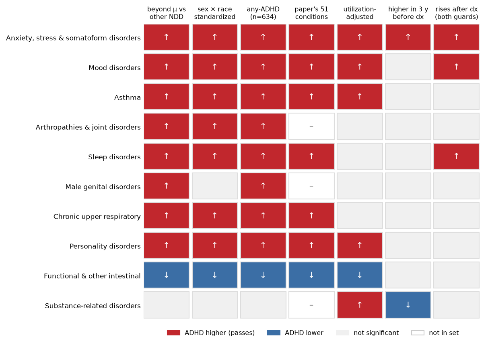
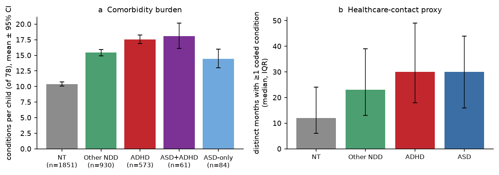
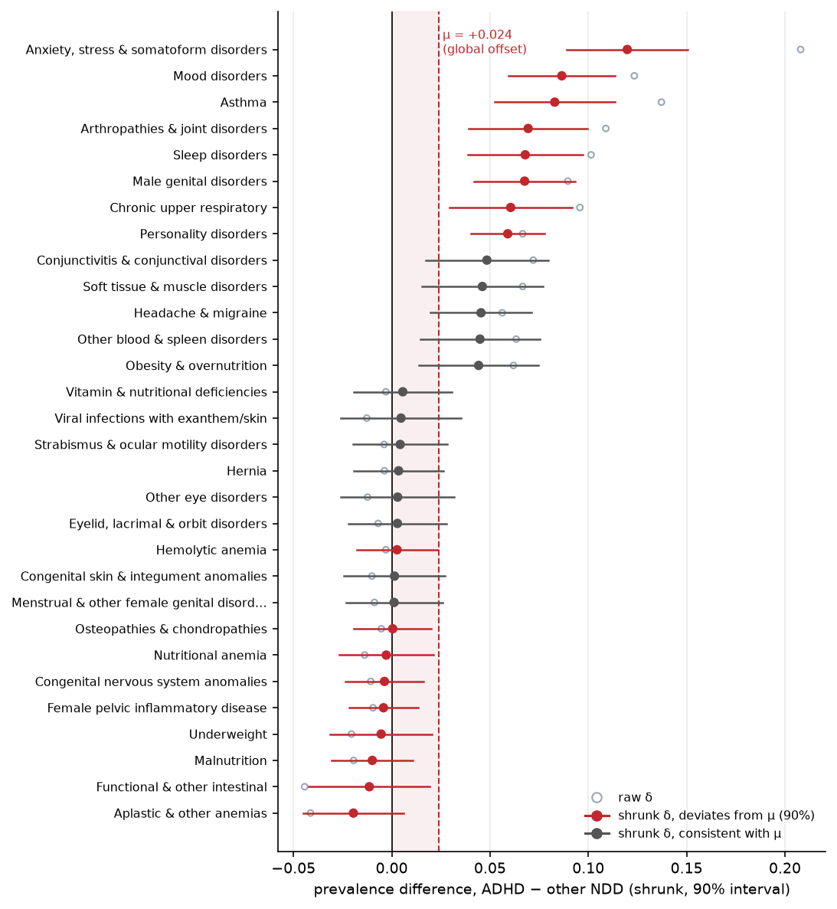
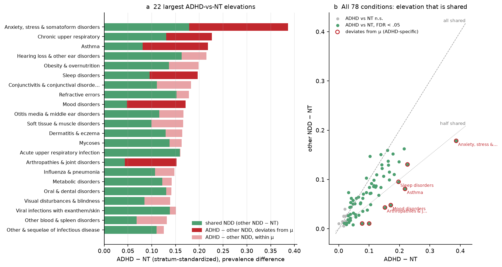
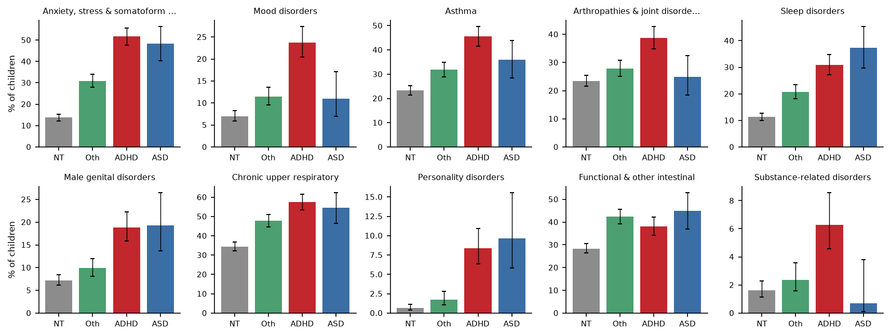
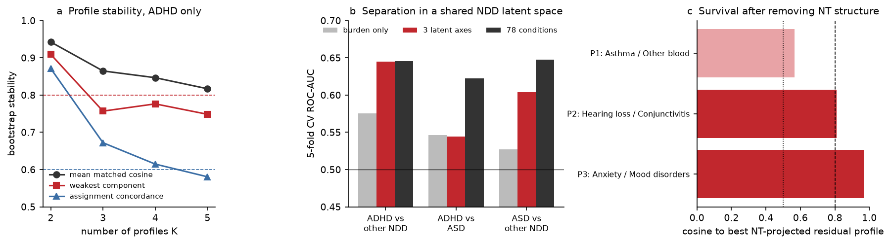
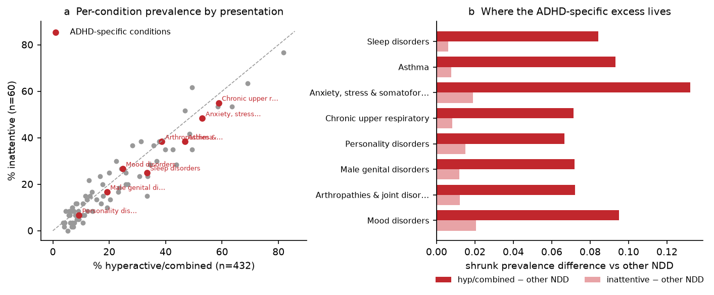
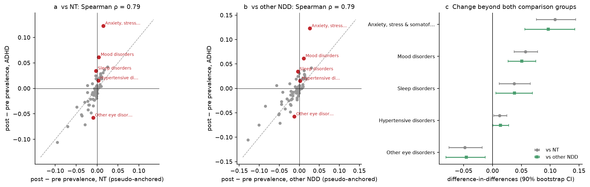
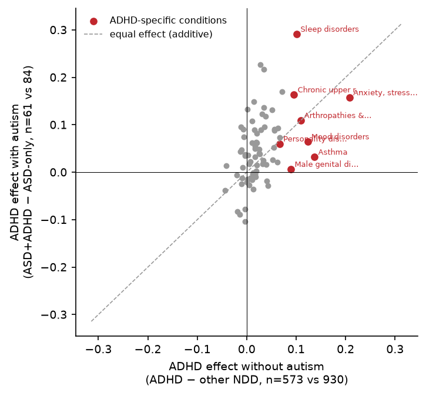
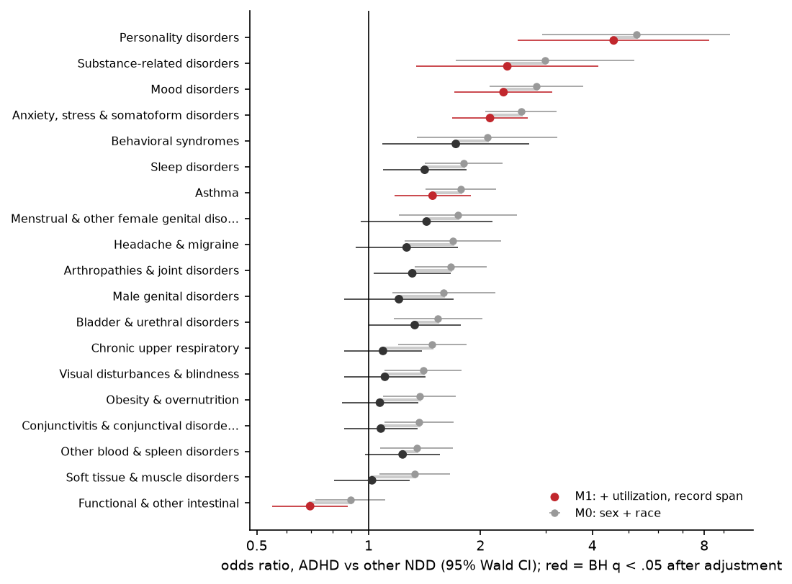

# ADHD-specific comorbidity in the Boston Birth Cohort

Analyses D1–D7, run 2026-10-13, write-up revised 2026-10-14. Scripts live in `adhd_analysis/` and outputs in `results/`.
`./run_all.sh` reruns D1 and D4–D7. D3 runs on its own (`python d3_profiles.py`). Figures come from `python make_figures.py`, and
this page from `python md_to_html.py`. Every number below is aggregate. Per-child data stays in `_cache/`.

[TOC]

## Executive summary

| # | Question | Verdict |
|---|---|---|
| D1 | Which conditions are ADHD-specific rather than shared with other NDD? | **Few, and they cluster.** ADHD sits a uniform $\hat\mu=+0.024$ above other-NDD across all 78 conditions, a level shift that is largely utilization (D7). 31 conditions have $\delta>0$, but only **8 deviate beyond $\mu$**: anxiety, mood, asthma, arthropathies, organic sleep, male genital, chronic URT and personality. They replicate 8/8 under any-ADHD and 6/6 in the paper's 51. Male genital is lost under sex×race standardization. |
| D2 | Step or gradient? | ADHD-specific conditions are mostly **steps**: other-NDD covers under half of the ADHD elevation (shared fraction: personality 0.14, mood 0.28, arthropathies 0.28, asthma 0.37, anxiety 0.46). Most of the other large ADHD-vs-NT elevations are 60–110% shared NDD (refractive 0.85, eczema 0.79, acute URI 0.99, dental 0.92). |
| D3 | Do the ADHD NMF profiles survive? | ADHD-only K=3 is **not reportable**: the weakest component scores 0.76, below the 0.80 floor, while K=2 is stable. Under NT projection the **psychiatric profile survives** (cos 0.97), ENT/infectious survives (0.81) and asthma/blood is partial (0.57). ADHD-vs-other AUC is 0.645 (permutation p=0.005) against 0.576 for burden alone. |
| D4 | Inattentive vs hyperactive/combined | **No condition differs beyond the burden offset.** Inattentive ADHD (n=60) has **no global excess over other-NDD** ($\hat\mu\approx 0.001$), and hyperactive/combined carries all of it ($\hat\mu=+0.028$). |
| D5 | What changes around the ADHD diagnosis? | Around the diagnosis, ADHD's change tracks the comparison groups' changes (ρ = 0.79 with both). **Anxiety (+0.10), mood (+0.05) and organic sleep (+0.04)** rise beyond **both** guards. In the 3 years *before* diagnosis, only **anxiety** exceeds other-NDD beyond $\mu$. |
| D6 | ADHD-only vs ASD+ADHD vs ASD-only | **The two diagnoses add.** Interaction $\hat\tau^2=0$ and 0/78 conditions survive. ADHD adds the same uniform burden with autism ($\hat\mu=+0.033$) as without (+0.024). Children with both get their ADHD diagnosis *earlier* (6.5 vs 7.1 y, p=0.04). |
| D7 | Does it survive a utilization denominator? | Median event-months: NT 12, other-NDD 23, ADHD 30, ASD 30. vs other-NDD, BH-significant conditions fall **from 18 to 6** after adjustment: **anxiety OR 2.12, mood 2.31, personality 4.56, substance 2.36, asthma 1.49**, and **constipation lower (0.70)**. |

<b>Figure 0. Robustness of each candidate ADHD-specific condition.</b> Rows: the 8 conditions that deviate beyond the global offset vs other NDD, plus the 2 that are significant only after utilization adjustment (constipation lower, substance use higher). Columns, left to right: (1) shrunk ADHD − other-NDD deviation beyond μ, 90%; (2) the same after sex×race direct standardization; (3) the same with any-ADHD (n=634) as the case group; (4) the same within the paper's 51-condition set ("–" = not in that set); (5) utilization-adjusted logistic OR, BH q &lt; .05; (6) excess beyond μ in the 3 years before the ADHD diagnosis; (7) post-minus-pre change exceeding both pseudo-anchored comparison groups. Red = ADHD higher, blue = ADHD lower, grey = not significant. The substance-use "lower before diagnosis" cell is a near-zero cell (substance codes are rare before ~age 10) and should be ignored.

**Bottom line.**

1. **An ADHD-vs-NT design overstates ADHD specificity about tenfold.** 68 conditions are elevated vs NT (FDR<.05). Most of that elevation is shared NDD burden and higher utilization: 8 conditions deviate beyond the uniform ADHD offset, and 6 survive utilization adjustment.
2. **The robust ADHD-specific core is psychiatric (anxiety, mood, personality-disorder codes, substance use\*) plus asthma.** Asthma is the one non-psychiatric condition that survives every guard. Constipation is a utilization-adjusted ADHD *deficit*. \*Substance use is provisional: about 40% of its under-18 codes are neonatal withdrawal or tobacco-exposure codes recorded on young children (§8.1).
3. **The ADHD-vs-ASD contrast is clean.** ASD's specific signal was congenital and neurologic (epilepsy, glaucoma; S7). ADHD's is psychiatric and behavioral, plus asthma.
4. **Temporal.** The anxiety excess is present *before* the ADHD diagnosis. Anxiety, mood and sleep rise further after it, beyond both age and NDD-care guards. ADHD workups also code anxiety and mood, though, so this co-coding is not yet ruled out.

---

## 1. Data and shared processing

### 1.1 Sources

All inputs are on the `<PROJECT_ROOT>/` cluster share and are **not** in the repository.

| Input | File | Content used |
|---|---|---|
| NDD labels | `NDD datasets 3-24-2026/chs_ndd_mental_03232026.csv` | 3,500 children. Diagnosis flags (`ASD`, `ADHD`, `other_NDD_DSM5`, and component flags), group code `NDD`, first-diagnosis ages (`ASD_firstdiag_years`, `ADHD_firstdiag_years`), and `ADHD_diag_n_of_visit` |
| Birth cohort baseline | `primary_teleform03202026.csv` | Sex, birth year and month, race (`race_update`), maternal education (`edu`), preterm (`preterm1`), LBW, maternal covariates |
| EHR diagnoses | `kid_icdcode_data_Mar2026.RDS` | One row per coded diagnosis: `ID`, `serviceDate`, `icdcode` (ICD-9-CM and ICD-10-CM) |
| Child anthropometry | `BBC_underage20_HTWT_BMI_clean031626.csv` | BMI-for-age z-scores (`bmiz`) by age in months |
| Category codebook | `BBC_Dataset/preprocessing/ICD_Codes_Extension.xlsx` | ICD-9/10 codes and ranges → 15 disease categories |
| Condition codebook | `BBC_Dataset/conditions/icd_condition_mapped.xlsx` (Supplementary Table 2) | ICD-9/10 codes and ranges → granular conditions |

These feed the derived tables used by every analysis, `BBC_patients_analytic_full.csv` and `BBC_event_table_full.csv`
(`BBC_Dataset/preprocessing/results/`). Both were built by the ASD-paper pipeline (`BBC_Dataset/preprocessing/preprocessing.py`
and `event.py`) run with all four labels retained (`BBC_COHORT_SUFFIX=_full`). The ADHD analyses add no further sample filtering
except where a section says so (D5 eligibility, D4 presentation classes).

### 1.2 Cohort construction and groups

**Steps, with counts:**

1. **Start:** 3,500 children in the NDD label file.
2. **Mutually exclusive priority label** from the label-file flags: `ASD`=1 → **ASD**; else `ADHD`=1 → **ADHD**; else `other_NDD_DSM5`=1 → **Other NDD**; else **NT**. The file's `NDD` column carries the same code (0 NT, 1 ASD, 2 ADHD, 3 other). We verified that the derived table's `label` matches this rule for 3,499 of 3,499 children.
3. **Exclusion:** one child (ID 3490, whose group code is missing) is dropped by the pipeline, leaving NT at 1,851. All other children join to the baseline file with valid sex (F/M) and birth year and month, so **3,499 children are analysed**.
4. **Covariates:**
   - DOB is set to day 15 of the birth month.
   - Black = `race_update` ∈ {1, 5}.
   - Maternal education has 3 levels: `edu` ≤ 2 less than high school, 3 high school, ≥ 4 college or higher. The 44 missing values are imputed as "College or higher"; this affects only the NT standardization strata.
5. **No exclusion for lack of records.** 42 children have no mapped condition before age 18 (NT 35, other-NDD 3, ADHD 3, ASD 1). They are kept as all-zero rows, so prevalences use every labelled child as the denominator.

**What defines each NDD group.** The table counts children with each component flag in the label file. The expansions are our
reading of the abbreviations. Other NDD is defined by `other_NDD_DSM5` (930/930).

| Flag in label file | NT (1,851) | Other NDD (930) | ADHD (573) | ASD (145) |
|---|---|---|---|---|
| `CD` (communication disorder) | 0 | 618 | 246 | 115 |
| `misc_DD` (other developmental delay) | 0 | 332 | 203 | 105 |
| `LD` (learning disorder) | 0 | 228 | 280 | 66 |
| `conduct` (conduct / oppositional) | 0 | 208 | 312 | 57 |
| `ID` (intellectual disability) | 0 | 28 | 19 | 36 |
| `MD` (motor disorder) | 0 | 30 | 18 | 7 |
| `TD` (tic disorder) | 0 | 25 | 25 | 5 |
| `AD` (anxiety disorder)\* | 155 | 159 | 150 | 32 |
| `MDD` (major depression)\* | 111 | 74 | 75 | 6 |
| `PTSD`\* | 37 | 42 | 85 | 2 |

\*`AD`, `MDD` and `PTSD` do **not** define any group, and they occur in NT children too. NT means *no neurodevelopmental
diagnosis*, not *no psychiatric diagnosis*. The most common Other-NDD profiles are communication disorder alone (281),
communication + developmental delay (78), developmental delay alone (76) and learning disorder alone (48).

**Analysis groups:**

| Group | n | Definition | Used in |
|---|---|---|---|
| NT | 1,851 | label = NT | reference everywhere |
| Other NDD | 930 | label = Other NDD (no ASD, no ADHD) | **primary comparator** |
| **ADHD** | **573** | label = ADHD (ADHD without ASD) | **primary case group** |
| ASD | 145 | label = ASD | D1 (vs ASD) |
| ASD+ADHD | 61 | ASD and `ADHD` flag = 1 | D6 |
| ASD-only | 84 | ASD and `ADHD` flag = 0 | D6 |
| any-ADHD | 634 | ADHD ∪ ASD+ADHD (the main-branch definition) | D1 sensitivity |
| rest (non-ADHD NDD) | 1,075 | ASD ∪ Other NDD | D1 ($\delta_{\text{rest}}$) |
| spectrum | 1,648 | ASD ∪ ADHD ∪ Other NDD | D1 standardization target, D3(b) |

**Diagnosis ages and visits.** ADHD diagnosis age is `ADHD_firstdiag_years`, with median 7.1 y (IQR 5.4–9.3, n=634 any-ADHD); ASD's is 3.25 y.
`ADHD_diag_n_of_visit` (median 5 visits in ADHD) is reported but not used as a filter.

<b>Figure 1.</b> (a) Mean number of the 78 conditions ever coded per child (0–18 y), with 2,000-replicate bootstrap 95% CI. (b) Median (IQR) number of distinct months of age with at least one coded condition, a proxy for healthcare contact. ADHD children carry 2.1 more conditions than other-NDD children (MWU p&lt;10⁻⁴) and have 30% more event-months.

### 1.3 Diagnosis events: ICD processing and grouping

`event.py` turns raw EHR codes into condition events as follows:

1. **Raw rows:** each row of `kid_icdcode_data_Mar2026.RDS` is one diagnosis at one service date. Rows with a missing date or code are dropped.
2. **Code cleaning and version assignment.**
   - Codes are uppercased, and every character except letters, digits and "." is stripped. A dot is inserted after the 3rd character if absent.
   - **V-codes are dropped** (ICD-9 supplementary classification).
   - E-codes are kept only if they parse as ICD-10 E00–E89 *and* the service date is on or after 2015-10-01. ICD-9 external-cause E-codes are dropped. (The category codebook also has **no injury category**, so injury codes S00–T88 and 800–999 never become events.)
   - Otherwise, letter + 2 digits → ICD-10, and 3 digits → ICD-9.
3. **Age:** age in months is the calendar-month difference between service date and DOB. Events before birth are dropped; `age_years` = months / 12.
4. **Disease category** (`ICD_Codes_Extension.xlsx`): the exact code is looked up first, then its 3-character stem against listed ranges (e.g. `J45-J46` covers J45 and J46). Phenotype rows for ASD, ADHD and NDD are skipped, and **codes with no category are dropped**. Resulting categories:
   - Cardiovascular, Congenital, Digestive, Endocrine–Metabolic, Hematologic & Immune;
   - Infectious Disease, Integumentary, Musculoskeletal, Neoplastic, Neurologic;
   - Psychiatric, Reproductive, Respiratory, Sensory, Urinary.
5. **Codes that define the groups cannot be outcomes.** These are removed:
   - ICD-9 299, 307.2, 312, 314, 315, 317–319;
   - ICD-10 F70–F82, F84, F88–F91, F95.

   So ADHD (F90/314), conduct (F91/312), tic (F95/307.2) and developmental codes never appear as outcomes. Anxiety (F40–F48), mood (F30–F39), personality (F60–F69) and substance (F10–F19) codes **are** retained.
6. **Condition** (`icd_condition_mapped.xlsx`, column *Conditions by Organ/System*): each code is matched to the **longest listed prefix**, so `F41.1` matches an `F41` entry. Ranges expand over 3-character stems. A category-mapped code with no condition is kept with an empty condition and is dropped at analysis.
7. **Collapse** to one row per child × month × category × condition. The source codes are kept in `codes`.
8. **BMI override for weight status.**
   - For every child with at least one BMI measurement, ICD obesity rows are **removed** and replaced by measurement-derived events. BMI-for-age z-scores with |z| > 5 or age < 24 months are dropped.
   - z < −1.645 → **Underweight** (a condition with no ICD counterpart). 1.036 ≤ z < 1.645 (overweight) and z ≥ 1.645 (obese) both → **Obesity & overnutrition**.
   - Only category transitions are kept as events. Children with no BMI data keep their ICD obesity codes.
9. **Congenital** conditions keep only their first occurrence per child.

**Result:** 151,263 event rows for 3,464 children, covering 123 conditions in 15 categories. At analysis load (`clustering_utils.load_event_data`),
rows with an empty condition and events at age ≥ 18 are dropped, leaving 3,457 children with at least one event. Appendix A lists the ICD-9
and ICD-10 definition of every condition analysed here.

### 1.4 Analysed condition set

For child $i$ and condition $j$, the outcome is ever-coded presence before 18:
$$y_{ij}=\mathbb 1\{\text{child } i \text{ has}\ge 1 \text{ event of condition } j \text{ at age} <18\}.$$
The **adhd78** set applies the ASD paper's selection rule with ADHD in place of ASD, but over **all** disease categories (the
paper used 7). A condition is kept if at least 5 ADHD children have it and $\hat p_{\text{ADHD},j}\ge 0.03$. The rule yields $J=78$
conditions (Appendix A; `results/condition_definitions_adhd78.csv`), 47 of which overlap the paper's 51. The paper's 51 (`nmf_kept_conditions.txt`) are a
sensitivity set. Group prevalence is $\hat p_{g j}=n_g^{-1}\sum_{i\in g}y_{ij}$.

### 1.5 Stratum-standardized NT reference

Analyses that subtract an NT baseline use the same NT rate as the ASD paper and S1/S5. Strata $s$ are sex × Black (yes/no) × maternal
education (missing coded as a level). The rate is directly standardized to the full-cohort stratum distribution $w_s$. NT strata with fewer than 5 children are pooled into a single stratum:
$$r^{NT}_j=\sum_{s\,\in\,\text{valid}} w_s\,\hat p^{NT}_{sj}\;+\;\Big(\sum_{s\,\in\,\text{pooled}} w_s\Big)\hat p^{NT}_{\text{pooled},j}.$$

### 1.6 Empirical-Bayes shrinkage across conditions (D1, D4, D5, D6)

Every per-condition prevalence contrast between two groups $a,b$ is shrunk jointly across the $J$ conditions. This shrinkage is the multiplicity control.

*Raw contrast and SE.* $\hat\delta_j=\hat p_{aj}-\hat p_{bj}$. The SE uses Agresti–Caffo-adjusted proportions $\tilde p=(x+1)/(n+2)$, so a 0/61 cell
does not get $s_j\approx 0$:
$$s_j^2=\frac{\tilde p_{aj}(1-\tilde p_{aj})}{n_a+2}+\frac{\tilde p_{bj}(1-\tilde p_{bj})}{n_b+2}.$$

*Random-effects model.* $\hat\delta_j\mid\delta_j\sim N(\delta_j,s_j^2)$ and $\delta_j\sim N(\mu,\tau^2)$. $\tau^2$ is estimated by
DerSimonian–Laird:
$$w_j=s_j^{-2},\quad \hat\mu_{FE}=\frac{\sum w_j\hat\delta_j}{\sum w_j},\quad Q=\sum w_j(\hat\delta_j-\hat\mu_{FE})^2,\quad
\hat\tau^2=\max\!\Big(0,\frac{Q-(J-1)}{\sum w_j-\sum w_j^2/\sum w_j}\Big),$$
$$\hat\mu=\frac{\sum_j \hat\delta_j/(s_j^2+\hat\tau^2)}{\sum_j 1/(s_j^2+\hat\tau^2)},\qquad \operatorname{Var}(\hat\mu)=\Big[\sum_j (s_j^2+\hat\tau^2)^{-1}\Big]^{-1}.$$

*Posterior.* With $B_j=\hat\tau^2/(\hat\tau^2+s_j^2)$, the shrunk estimate is $\tilde\delta_j=\hat\mu+B_j(\hat\delta_j-\hat\mu)$.

Two tests are reported, each at 90% (z = 1.645; 95% also stored):

- **vs 0** ("$\delta\neq 0$"): Morris posterior SD $\sigma_j=\sqrt{B_j s_j^2+(1-B_j)^2\operatorname{Var}(\hat\mu)}$. The condition survives if $\tilde\delta_j\pm z\sigma_j$ excludes 0.
- **beyond μ** ("specific"): the condition-specific deviation $\tilde\delta_j-\hat\mu=B_j(\hat\delta_j-\hat\mu)$ with SD $\sqrt{B_j}\,s_j$. It survives if $|\tilde\delta_j-\hat\mu|>z\sqrt{B_j}s_j$.

**This is the key test.** When one group is coded more for *everything*, every $\delta_j$ inherits $\mu$, so "$\delta\neq0$"
flags generic over-coding. "Beyond μ" asks which conditions depart from the group's own level shift.

In words: $\hat\mu$ is a precision-weighted mean of the per-condition differences, with weights $1/(s_j^2+\hat\tau^2)$. Each pair of groups gets its own fit, so $\hat\mu$ belongs to a *contrast*, not a group. Values are reported in each section. ADHD vs NT is not shrunk; D1 tests it per condition with FDR.

*Changes from S5.* S5 omitted $\operatorname{Var}(\hat\mu)$, so with $\hat\tau^2=0$ the SD collapsed to 0 and every condition "survived".
S5 also had no beyond-μ test and used Wald SEs.

### 1.7 Utilization proxy (D4, D6, D7)

For each child, **event-months** are the number of distinct integer months of age, $\lfloor \texttt{month}\rfloor$, with at least one coded
condition of any kind (all conditions, not just the 78) before age 18. **Record span** is the age at the last event minus the age at the first.
There is no visit-level denominator (no encounters without a diagnosis), so this is a lower-bound contact proxy.

---

## 2. D1: which conditions are ADHD-specific?

**Question.** An ADHD-vs-NT comparison (the main branch) can only call a condition *ADHD-associated*. Which associations exceed what any NDD child shows?

**Data.** Groups ADHD (573), Other NDD (930), rest (1,075), ASD (145) and NT (1,851); the adhd78 conditions; ever-presence $y_{ij}$ (§1.4).

**Processing.** Raw group prevalences $\hat p_{gj}$. The stratum-standardized NT rate $r^{NT}_j$ (§1.5). For the sex×race sensitivity, a second
direct standardization of ADHD and other-NDD over the 4 sex × Black strata, with weights from the spectrum pool (1,648) and strata under 5 pooled. This
removes the sex imbalance: 69% male in ADHD vs 52% in other-NDD.

**Statistical formulation.** The ADHD elevation over NT decomposes exactly as
$$\underbrace{\hat p_{\text{ADHD},j}-r^{NT}_j}_{e_j\ \text{(ADHD vs NT)}}=\underbrace{\hat p_{\text{oth},j}-r^{NT}_j}_{\text{shared NDD}}+\underbrace{\hat p_{\text{ADHD},j}-\hat p_{\text{oth},j}}_{\delta^{\text{oth}}_j\ \text{(ADHD-specific)}}.$$

1. *Association vs NT.* Two-proportion Wald $z_j=(\hat p_{\text{ADHD},j}-\hat p_{NT,j})/\sqrt{\hat p_A(1-\hat p_A)/n_A+\hat p_{NT}(1-\hat p_{NT})/n_{NT}}$, two-sided, with Benjamini–Hochberg FDR over $J$. This test uses raw NT prevalence; $e_j$ uses $r^{NT}_j$.
2. *Specificity.* Three contrasts, each shrunk on its own (§1.6): $\delta^{\text{oth}}$ = ADHD − other-NDD (**primary**), $\delta^{\text{rest}}$ = ADHD − (ASD ∪ other), and $\delta^{\text{ASD}}$ = ADHD − ASD.
3. *Labels* (90%, vs 0):
   - **ADHD-SPECIFIC:** $\delta^{\text{oth}}>0$ and $\delta^{\text{ASD}}>0$ both survive.
   - **ADHD+ASD:** only $\delta^{\text{oth}}>0$ survives.
   - **ADHD-DEFICIT:** $\delta^{\text{oth}}<0$ survives.
   - **ASD-PEAK:** $\delta^{\text{oth}}$ is n.s. and $\delta^{\text{ASD}}<0$ survives.
   - **ABOVE-ASD:** $\delta^{\text{oth}}$ is n.s. and $\delta^{\text{ASD}}>0$ survives.
   - Otherwise **SHARED-NDD** ($|e_j|\ge 0.03$) or **FLAT**.

   The headline set is the **beyond-μ** survivors of $\delta^{\text{oth}}$.
4. *Sensitivity grid.* {adhd78, paper51} × {ADHD 573, any-ADHD 634}. For any-ADHD, the comparators become ASD-only and ASD-only ∪ other.

**Results.**

- **ADHD vs NT:** 68 of 78 conditions are elevated (FDR<.05).
- **ADHD vs other-NDD:** $\hat\mu=+0.024$ and $\hat\tau=0.027$. 31 conditions survive $\delta>0$ (22 at 95%). Labels: 10 ADHD-SPECIFIC, 21 ADHD+ASD, 7 ABOVE-ASD, 31 SHARED-NDD, 9 FLAT, and 0 ADHD-DEFICIT.
- **Beyond μ: 8 conditions up, 10 down.**
  - Up (deviation $\tilde\delta-\hat\mu$): anxiety +0.096, mood +0.063, asthma +0.059, arthropathies +0.045, organic sleep +0.044, male genital +0.044, chronic URT +0.037, personality +0.035.
  - Down: a set of anemias, nutrition and congenital-nervous conditions, plus constipation/IBS (−0.035). These are conditions ADHD has at about the other-NDD level while other conditions sit μ higher.
- **Robustness.**
  - All 8 replicate under any-ADHD (which finds 9), and 6/6 of those present in the paper's 51 replicate.
  - Under sex×race standardization, 7/8 hold; male genital is lost.
  - $\hat\mu$ and $\hat\tau$ barely move across the grid ($\hat\mu$ 0.022–0.025, $\hat\tau$ 0.027–0.032).

<b>Figure 2. ADHD − other NDD, per condition.</b> The 30 conditions with the largest |shrunk δ − μ|. Open circles: raw δ. Filled circles and lines: shrunk δ with 90% interval (the vs-0 Morris SD). Dashed line: global offset μ̂ = +0.024. Red marks conditions whose deviation from μ survives at 90%. The beyond-μ test uses the narrower deviation SD, which leaves out Var(μ̂), so a red point's plotted interval can touch μ.

## 3. D2: step or gradient?

**Question.** For conditions where ADHD exceeds NT, is other-NDD most of the way there (a gradient over severity or care), or does ADHD
jump above it (a step)?

**Data and processing.** As in D1, using the adhd78 conditions and ADHD 573.

**Statistical formulation.** The shared fraction is
$$\mathrm{sf}_j=\frac{\hat p_{\text{oth},j}-r^{NT}_j}{\hat p_{\text{ADHD},j}-r^{NT}_j}.$$
- For D1-elevated conditions (ADHD-SPECIFIC or ADHD+ASD), **STEP** if $\mathrm{sf}_j<0.5$ and **GRADIENT** otherwise.
- For SHARED-NDD conditions with $e_j>0$, **PLATEAU** if $\mathrm{sf}_j\ge 0.85$.
- An ordered Cochran–Armitage trend statistic over NT < other < ADHD (scores 0, 1, 2) is also reported:
$$z_j=\frac{\sum_g t_g(x_{gj}-n_g\bar p_j)}{\sqrt{\bar p_j(1-\bar p_j)\big[\sum_g n_g t_g^2-(\sum_g n_g t_g)^2/N\big]}}.$$

**Results.**

- The beyond-μ core are mostly steps, ordered by shared fraction:

  | Condition | Shared fraction |
  |---|---|
  | Male genital | 0.11 |
  | Personality | 0.14 |
  | Mood | 0.28 |
  | Arthropathies | 0.28 |
  | Asthma | 0.37 |
  | Anxiety | 0.46 |
  | Sleep | 0.48 |
  | Chronic URT (the exception: a gradient) | 0.58 |

- The large ADHD-vs-NT elevations outside the core are mostly 60–110% shared: acute URI 0.99, dental 0.92, metabolic 0.86, refractive errors 0.85, mycoses 0.84, eczema 0.79, hearing/ear 0.76, influenza/pneumonia 0.73. Other NDD is nearly as high as ADHD on these.
- Every condition has a positive NT < other < ADHD trend (z from 0.15 to 19).

<b>Figure 3. What an ADHD-vs-NT elevation is made of.</b> (a) For the 22 largest ADHD − NT elevations, the green bar is the part other-NDD also shows (other − NT). The red bar is the part beyond other-NDD; it is dark when that deviation survives beyond μ. (b) Every condition plotted as other − NT against ADHD − NT. The dashed line (y = x) marks fully shared elevation and the dotted line (y = x/2) a shared fraction of 0.5, the step/gradient cutoff. The circled ADHD-specific conditions sit near or below the "half shared" line.

<b>Figure 4. Prevalence by group for the robust conditions.</b> Bars show the % of children ever coded before 18, with Wilson 95% CIs. The NT bars are raw (not standardized). In ASD (n=145), anxiety, sleep, chronic URT, male genital and personality are as high as in ADHD, which is why D1 labels them ADHD+ASD. Mood, asthma, arthropathies and substance use peak in ADHD alone.

## 4. D3: do the ADHD comorbidity profiles survive?

**Question.** Linna's main branch reports K=3 NT-residualized NMF profiles in ADHD (MSK–injury, psychiatric–internalizing,
atopic-ENT–infectious). Three questions follow. Are the profiles stable? Do they separate ADHD from other NDD beyond burden? And do they survive removal of the structure NT children also show?

**Data.** The adhd78 conditions. (a) ADHD 573. (b) Spectrum 1,648. (c) NT 1,851 for the basis, then ADHD, other-NDD and ASD. The injury
category is absent, so the MSK–injury profile cannot be reproduced.

**Processing and statistical formulation.**

*(a) ADHD-only NMF* (ASD-paper pipeline).
- **Residual rows:** $x_{ij}=\max(y_{ij}-r^{NT}_j,0)$, L2-normalized per child. Children with zero residual are dropped (570/573 kept).
- **Model:** $X\approx WH$ with $W\in\mathbb R_{\ge0}^{n\times K}$ and $H\in\mathbb R_{\ge0}^{K\times J}$, minimizing the Frobenius loss by multiplicative updates. Random initialization, best of 20 restarts.
- **Stability:** nonparametric bootstrap over children, $B=200$ replicates with 3 restarts each. Each replicate's $H^{(b)}$ is Hungarian-matched to the reference $H$ by cosine. Reported:
  - mean matched cosine;
  - the weakest component's mean cosine;
  - assignment concordance, the share of children whose dominant component $\arg\max_k W_{ik}$ agrees after matching.
- **Pre-registered floors:** cosine ≥ 0.80, weakest ≥ 0.80, concordance ≥ 0.60.
- **K scan:** 2–5 (12 restarts, B=80).

*(b) Shared-space separation.* K=3 NMF on the spectrum residuals gives $W$. For a binary contrast (ADHD vs other, etc.) we fit an $\ell_2$ logistic
regression on standardized features with balanced class weights and report 5-fold stratified CV ROC-AUC. Feature sets:
- latent $W$ (3 columns);
- the raw residual matrix (78);
- burden $\sum_j \mathbb 1\{x_{ij}>0\}$ alone;
- $W$ + burden.

The permutation p-value comes from 200 label shuffles, $p=(1+\#\{\text{AUC}_\pi\ge\text{AUC}_{obs}\})/201$. Its floor is 0.005.

*(c) NT-normative projection (B2).*
1. Fit NMF with $K_{NT}=12$ (Linna's `NT_BASIS_K`; nndsvda init) to NT raw presence, giving $H_{NT}$.
2. Project each ADHD child by non-negative least squares, $\hat w_i=\arg\min_{w\ge0}\lVert y_i-H_{NT}^\top w\rVert_2$, and keep the residual $R_i=\max(y_i-H_{NT}^\top\hat w_i,0)$.
3. Fit K=3 NMF on the L2-normalized $R$ (20 restarts, bootstrap B=100).
4. Compare each (a) profile to its best-matching residual component by cosine: **SURVIVES** ≥ 0.80, **PARTIAL** ≥ 0.50, otherwise DISSOLVES.

Structural atypicality: $r^{\text{norm}}_i=\lVert y_i-H_{NT}^\top\hat w_i\rVert_2$. NT children are scored out-of-fold (5-fold refit of the basis).
Because $r^{\text{norm}}$ grows with burden, groups are compared on $r^{\text{norm}}_i/\sqrt{\text{burden}_i}$ with Mann–Whitney U.

**Results.**

- **(a) ADHD-only NMF.** K=3 gives cosine 0.868, weakest component 0.763 and concordance 0.677, so it is **not reportable**; the weakest-component floor fails, as in the ASD paper. K=2 is stable (0.943 / 0.909 / 0.871). The K=3 profiles are:
  - P1, asthma / other blood / refractive (n=190);
  - P2, ear / conjunctivitis / otitis / viral exanthem (n=301);
  - P3, anxiety / mood / sleep / personality (n=79).
- **(b) Shared-space separation.** ADHD vs other-NDD: AUC 0.645 on latent $W$, 0.645 on raw residuals, 0.576 on burden alone (p=0.005). The ADHD-loaded spectrum axis is the anxiety/mood axis (ADHD − other mean weight +0.093). ADHD vs ASD is near chance in the latent space (0.545).
- **(c) NT-normative projection.** The residual NMF is stable (0.919 / 0.861 / 0.787). P3 (psychiatric) survives at cos 0.967, P2 (ENT/infectious) at 0.811, and P1 (asthma/blood) is partial at 0.565.
- **Structural atypicality.** Burden-adjusted $r^{\text{norm}}$ is the same for ADHD and other-NDD (median 0.661 vs 0.662, p=0.88). It is higher in ASD than in ADHD (0.687, p=0.005), and other-NDD and NT differ (p<10⁻⁴). ADHD is *more* comorbid but not *differently* structured once burden is accounted for.

**Limitations.**

- **Panel b uses a different NMF from panel a.** Panel a is the ADHD-only fit (573 children), which fails the stability floors. Panel b uses a K=3 fit to all 1,648 NDD children pooled; K=3 was chosen to match S2 and the paper. That pooled fit was **not** bootstrap-checked here, so its axes should not be read as profiles.
- **Panel b does not depend on the NMF.** The classifier predicts the *diagnostic group label* within NDD children (ADHD vs other-NDD, and so on). For ADHD vs other-NDD, the 78 raw conditions give the same AUC as the 3 axes (0.645 vs 0.645), and both beat burden alone (0.576). The finding "ADHD differs in *which* conditions, not just *how many*" therefore holds without any factorization.
- **Panel c compares against unstable reference profiles.** P1–P3 come from the non-reportable ADHD-only K=3. A low survival cosine can mean either of two things: the profile really is NT-type co-occurrence, or the profile is not reproducible even without residualization (weakest-component bootstrap cosine 0.76). The **PARTIAL verdict for P1 (asthma/blood) is therefore not interpretable as it stands.**
- **P3 (psychiatric, 0.97) is robust despite this.** Instability lowers similarity, so a near-maximal value is hard to reach by chance. The same profile also reappears independently in two other fits: the pooled-fit anxiety/mood axis (0.96 match) and the first residual component. D1 and D7 confirm its conditions one at a time.
- **K=3** mirrors the main branch (`nmf_analysis.py`, K=3; `NT_BASIS_K`=12) and the ASD paper, so we could test those profiles. Only K=2 is stable for ADHD alone.
- **Proposed fix** (not yet run):
  1. Report bootstrap stability per component, not only the minimum.
  2. Bootstrap the whole pipeline (resample ADHD, refit the ADHD-only K=3, residualize, refit, record each profile's survival cosine), giving an interval per bar. Then judge survival relative to each profile's own reproducibility.
  3. Add K=2 and NT-basis-size (6 / 12 / 20) sensitivity runs.

<b>Figure 5.</b> (a) Bootstrap stability of ADHD-only NT-residual NMF by K. Dashed lines are the pre-registered floors (0.80 for the cosine metrics, 0.60 for concordance); K=3 fails the weakest-component floor. (b) 5-fold CV ROC-AUC of logistic regression in the shared NDD latent space for three group contrasts and three feature sets. (c) Cosine between each ADHD-only K=3 profile and its best-matching component after projecting out a 12-component NT basis.

## 5. D4: inattentive vs hyperactive/combined presentation

**Question.** Within ADHD, does comorbidity differ by presentation? Both arms are ADHD children in the same clinics, so this contrast
is free of cross-diagnosis ascertainment.

**Data.** ADHD 573, raw ICD codes (`kid_icdcode_data_Mar2026.RDS`), and the adhd78 conditions.

**Processing.** We re-implemented Linna's `classify_subtype` exactly:
1. Normalize codes and count, per child, inattentive codes (ICD-10 F90.0, ICD-9 314.00) and hyperactive/combined codes (F90.1, F90.2, 314.01).
2. The majority wins.
3. Ties, or children with only F90.8/F90.9/314.0/314.8/314.9, are **Unspecified**. Children with no code are **Not classifiable**.

Result: hyperactive/combined 432, inattentive 60, unspecified 79, not classifiable 2. Sensitivity: children with ≥3 ADHD codes (inattentive 41, hyp/comb 345).

**Statistical formulation.** Three shrunk contrasts (§1.6): $\delta^{I-H}_j=\hat p_{I j}-\hat p_{H j}$; $\delta^{I-\text{oth}}_j$; and $\delta^{H-\text{oth}}_j$. Survival is tested beyond μ.

**Results.**

| | n | male % | ADHD dx age (median) | ADHD codes (median) | burden (mean) | event-months (median) |
|---|---|---|---|---|---|---|
| Hyperactive/combined | 432 | 70.8 | 6.9 | 10.5 | 17.9 | 31 |
| Inattentive | 60 | 60.0 | 8.6 | 6.0 | 16.2 | 25.5 |
| Unspecified | 79 | 62.0 | 7.7 | 2.0 | 16.7 | 26 |

- **Inattentive vs hyperactive/combined:** $\hat\mu=-0.024$ and $\hat\tau=0.014$. **0 of 78 conditions** deviate beyond μ, and the ≥3-code sensitivity gives the same result.
- **Each presentation vs other-NDD:** inattentive has $\hat\mu=+0.0007$ with 0 survivors; hyperactive/combined has $\hat\mu=+0.028$ with 9 survivors.
- **Conclusion:** the D1 ADHD excess, both the uniform shift and the specific core, sits in hyperactive/combined. Inattentive ADHD looks like other-NDD. Caveats: n=60, and ICD presentation coding defaults heavily to "combined".

<b>Figure 6.</b> (a) Per-condition prevalence in inattentive (n=60) vs hyperactive/combined (n=432) ADHD. The dashed line marks equality; most points sit slightly below it, reflecting the uniform offset μ̂ = −0.024. (b) Shrunk prevalence difference vs other NDD for the 8 ADHD-specific conditions, by presentation.

## 6. D5: what changes around the ADHD diagnosis?

**Question.** Do conditions rise after the ADHD diagnosis by more than they rise anyway with age (NT) and with entry into developmental care (other-NDD)? And which conditions already exceed other-NDD *before* the diagnosis?

**Data.** ADHD children with a known diagnosis age, all NT and all other-NDD children, the adhd78 conditions, and event ages.

**Processing.**

- **Anchor:** each ADHD child's own first-diagnosis age $a_i$.
- **Windows:** pre $=[a_i-3,a_i)$ and post $=[a_i,a_i+3)$, so the two sides have equal exposure. Window presence is $y^{\text{pre}}_{ij}=\mathbb 1\{\exists$ event $j$ in pre$\}$, and likewise for post.
- **Eligibility** is based on *administrative* follow-up, not on having events: $a_i\ge 3$, $a_i+3\le 18$, and age at data extract $\ge a_i+3$. Extract date is the latest event date in the cohort, and age at extract is that date minus the child's DOB. This leaves **521/573** ADHD children, anchor median 7.08 y.
- **Guards:** each NT and other-NDD child gets a pseudo-anchor drawn i.i.d. from the 521 eligible ADHD anchors, with the same eligibility rule. This is repeated for $R=20$ draws, giving a median of 1,795 NT and 885 other-NDD children eligible per draw. Guard quantities are averaged over the draws.

**Statistical formulation.**

- **Shift and DiD.** For group $g$ and condition $j$, $\Delta_{gj}=\bar y^{\text{post}}_{gj}-\bar y^{\text{pre}}_{gj}$, and
$$\text{DiD}^{NT}_j=\Delta_{\text{ADHD},j}-\Delta_{NT,j},\qquad \text{DiD}^{\text{oth}}_j=\Delta_{\text{ADHD},j}-\Delta_{\text{oth},j}.$$
- **Uncertainty.** Percentile bootstrap, $B=500$. Each replicate resamples ADHD children, and resamples guard children within pseudo-anchor draw $b \bmod 20$. A condition is significant if the 90% CI excludes 0. A condition **survives both guards** if both DiDs are significant with the same sign. The point estimate averages guard changes over all 20 draws, while each replicate uses one draw, so the intervals are slightly conservative.
- **Reshape-axis test** (as in A3b for ASD): Spearman $\rho(\Delta_{\text{ADHD}},\Delta_{g})$ across the 78 conditions. A high ρ means ADHD's reshape around diagnosis is the same age and care drift the guards show.
- **Pre-diagnosis set.** Shrunk beyond-μ contrast (§1.6) of $\bar y^{\text{pre}}_{\text{ADHD}}$ vs $\bar y^{\text{pre}}_{\text{oth}}$, with $n_{\text{oth}}$ set to the median eligible count.

**Results.**

- **Reshape-axis test:** $\rho(\Delta_{\text{ADHD}},\Delta_{NT})=0.79$ and $\rho(\Delta_{\text{ADHD}},\Delta_{\text{oth}})=0.79$, the same as A3b's 0.80 for ASD. Summed prevalence actually falls post vs pre in all groups (ADHD −0.37, NT −0.51, other −0.93), because early-childhood infections decline.
- **DiD:** 11 conditions are significant vs NT and 8 vs other-NDD. **5 survive both:**

  | Condition | DiD vs other | 90% CI | ADHD pre → post |
  |---|---|---|---|
  | Anxiety | +0.097 | [0.056, 0.142] | 14.2% → 26.5% |
  | Mood | +0.051 | [0.027, 0.075] | 3.8% → 10.0% |
  | Organic sleep | +0.038 | [0.006, 0.069] | 11.1% → 14.6% |
  | Hypertensive | +0.014 | [0.001, 0.028] | 1.0% → 2.5% |
  | Other eye | −0.045 | [−0.081, −0.012] | 10.4% → 4.6% |

  Hypertensive and other-eye are small-cell shifts.
- **Before diagnosis:** only **anxiety** exceeds other-NDD beyond μ: 14.2% vs 6.3% in the 3 years before diagnosis ($\hat\mu=+0.008$). The other pre-diagnosis survivors are near-zero cells (congenital anomalies, hernia, substance use) and are not interpretable.

<b>Figure 7.</b> Change in prevalence from the 3 years before to the 3 years after the ADHD diagnosis. (a, b) Each point is a condition: ADHD's change against the change in pseudo-anchored NT (a) or other-NDD (b) children. Red marks conditions whose difference-in-differences is significant against both comparison groups. (c) Difference-in-differences with 90% bootstrap CIs for those conditions.

## 7. D6: ADHD with and without autism

**Question.** The priority rule hides 61 children with both diagnoses inside "ASD". Is ADHD's comorbidity footprint the same with and without autism? What does each diagnosis add on top of the other? And is ADHD diagnosed later in autistic children (diagnostic overshadowing)?

**Data.** The 2×2 on the NDD side: ADHD yes/no × ASD yes/no, giving ASD+ADHD 61, ADHD-only 573, ASD-only 84 and other-NDD 930 (the "neither" cell). The adhd78 conditions, plus the patient covariates for descriptives.

**Statistical formulation.**

- **Shrunk contrasts (§1.6):**
  - autism-on-ADHD: $\hat p_{A+D}-\hat p_{D}$;
  - ADHD-on-autism: $\hat p_{A+D}-\hat p_{A}$.
- **Additivity, on the risk-difference scale:**
$$\text{int}_j=(\hat p_{A+D,j}-\hat p_{A,j})-(\hat p_{D,j}-\hat p_{\text{oth},j}),\qquad s^2_{\text{int},j}=\sum_{g\in\{A+D,A,D,\text{oth}\}}\frac{\tilde p_{gj}(1-\tilde p_{gj})}{n_g+2}.$$
  This is shrunk with its own DL fit; a survivor would be a condition where ADHD's effect depends on autism.
- **Descriptives:** burden mean with bootstrap CI, compared by MWU. ADHD diagnosis age compared by MWU. Diagnosis order is ADHD age minus ASD age within ASD+ADHD.

**Results.**

- **Additivity:** $\hat\tau^2_{\text{int}}=0$ ($Q=72.7$ on 77 df), $\hat\mu_{\text{int}}=+0.007$ (SE 0.006), and **0 of 78 conditions survive**. ADHD's effect is the same with autism as without.
  - ADHD-on-autism: $\hat\mu=+0.033$.
  - ADHD-on-other-NDD (D1): $\hat\mu=+0.024$.
  - Autism-on-ADHD: $\hat\mu=-0.001$, so autism adds no burden on top of ADHD.
- **Burden:** ASD+ADHD 18.1 ≈ ADHD 17.5 (p=0.33), both above ASD-only 14.5 (p=0.003).
- **Diagnosis timing:** ADHD is diagnosed *earlier* with autism (median 6.48 vs 7.13 y, MWU p=0.04). ASD came first in 61% of the 61, by a median of +1.0 y. This fits surveillance of children already in care, not overshadowing.
- **Survivors to ignore:** the three autism-on-ADHD survivors (malnutrition, female PID, chronic lower respiratory) are all 0/61 cells. The ADHD-on-autism survivors are mostly uniform-offset effects; none survive beyond μ.

<b>Figure 8. Is ADHD's effect the same with and without autism?</b> Each point is a condition. The x-axis is the ADHD effect among non-autistic NDD children (ADHD − other NDD); the y-axis is the ADHD effect among autistic children (ASD+ADHD − ASD-only). Points scatter around the identity line with no condition-specific departure (τ̂² = 0); the wider vertical spread reflects n = 61 and 84.

## 8. D7: utilization adjustment

**Question.** NDD children are seen more, and more contact means more codes. Do ADHD's condition-level excesses survive a per-child utilization denominator?

**Data.** ADHD vs other-NDD (**primary**, n=1,503) and ADHD vs NT (n=2,424). The adhd78 conditions, sex, Black race, and the utilization proxies (§1.7).

**Processing.** Utilization is computed **leave-condition-out**: for condition $j$, $U_{ij}$ is child $i$'s event-months minus the months in
which $j$ was the *only* coded condition, so condition $j$ cannot inflate its own denominator. Record span is defined in §1.7.

**Statistical formulation.** For each condition $j$ and each contrast, two logistic models:
$$\text{M0:}\ \operatorname{logit}\Pr(y_{ij}=1)=\beta_0+\beta_1\,\text{ADHD}_i+\beta_2\,\text{male}_i+\beta_3\,\text{Black}_i,$$
$$\text{M1:}\ \cdots+\beta_4\log(1+U_{ij})+\beta_5\,\text{span}_i.$$
- **Fitting:** Newton–Raphson with a $10^{-6}$ ridge for separation safety; Wald SEs from the observed information.
- **Inference:** BH FDR across the 78 conditions, within each contrast and model. Attenuation is $1-\hat\beta_1^{M1}/\hat\beta_1^{M0}$.
- **Interpretation:** utilization is partly a *consequence* of comorbidity, since sicker children are seen more. M1 therefore over-adjusts, and M0 → M1 brackets the truth rather than estimating it.

**Results.**

- **Utilization:**

  | Group | Median event-months (IQR) | Median record span |
  |---|---|---|
  | NT | 12 (6–24) | 10.0 y |
  | Other NDD | 23 (13–39) | 12.6 y |
  | ADHD | 30 (18–49) | 13.9 y |
  | ASD | 30 (16–44) | 13.3 y |

- **ADHD vs other-NDD:** BH-significant conditions fall from **18 to 6**, with median attenuation 0.38 among the M0-significant. The survivors (M0 OR → M1 OR):

  | Condition | M0 OR | M1 OR | q (M1) |
  |---|---|---|---|
  | Personality | 5.25 | 4.56 | 1e-5 |
  | Substance | 2.98 | 2.36 | 0.038 |
  | Mood | 2.82 | 2.31 | 3e-6 |
  | Anxiety | 2.57 | 2.12 | 2e-8 |
  | Asthma | 1.77 | 1.49 | 0.021 |
  | Constipation/IBS | 0.89 | 0.70 | 0.036 |

  The constipation deficit appears only after adjustment.
- **Lost under adjustment:** headache (1.69 → 1.27), arthropathies, organic sleep (q=0.087), male genital, chronic URT and the sensory/infectious set.
- **ADHD vs NT:** 70 → 18 significant, with median attenuation 0.84. Most of the NT-referenced literature signal is contact.

<b>Figure 9. ADHD vs other NDD before and after utilization adjustment.</b> Conditions significant (BH q &lt; .05) in either model. Grey: M0 (sex, race). Dark or red: M1 (adds log leave-condition-out event-months and record span). Red marks q &lt; .05 after adjustment. Lines are unadjusted 95% Wald CIs on a log scale, so a dark interval can exclude 1 (e.g. arthropathies, q = 0.17). ADHD-vs-NT models are in <code>d7_util_adjusted.csv</code> but are not plotted.

### 8.1 Condition-definition audit: substance use

Code-level audit of one of the six utilization-robust conditions.

- **Codebook** (`BBC_Dataset/conditions/icd_condition_mapped.xlsx`): *Substance-related disorders* = ICD-10 **F10–F19**, ICD-9 **303–305**. This covers alcohol, opioids, cannabis, sedatives, cocaine, stimulants, hallucinogens, **tobacco** (F17, 305.1), inhalants and polysubstance use.
- **Events under 18, all groups:** 163 events in 89 children, recounted from `BBC_event_table_full.csv`.

| Age at event | Events | Children | Dominant codes | Likely meaning |
|---|---|---|---|---|
| < 1 y | 33 (20%) | 21 | F19.939 ×25 (other psychoactive substance use with withdrawal), 305.1 ×6 | **Neonatal withdrawal** recorded with an adult code instead of P96.1 |
| 1–10 y | 29 (18%) | 18 | 305.1 / F17.2 ×21 (tobacco use disorder) | **Household or maternal smoke exposure** recorded as use |
| 10–14 y | 13 (8%) | 12 | mixed: tobacco, cannabis, opioid | Early use |
| 14–18 y | 88 (54%) | 49 | **F12 cannabis ×75**, tobacco ×10 | **Adolescent use** |

- 35 of the 89 children have only or partly early (< 10 y) codes, and just 3 have both early and late codes.
- **Implication.** The ADHD substance signal (utilization-adjusted OR 2.36) mixes two things:
  - adolescent substance use, the known ADHD comorbidity;
  - prenatal or early-life exposure, a known ADHD *risk factor* that belongs with the prenatal panel.
- **Pending.** Split the condition into exposure codes (< 10 y) and use (≥ 10 y), then rerun the ADHD vs other-NDD contrast on each part. Until then, treat "substance" in the robust core as provisional.
- The same audit is warranted for **personality disorders**. The definition is broad: ICD-10 F60–F69 includes habit and impulse-control disorders (F63) and gender-identity codes (F64), and ICD-9 301–302 includes 302.x sexual and gender-identity codes. Personality-disorder diagnoses proper are unusual before 18.

---

## 9. Caveats

- **Utilization (D7) over-adjusts**, so M0 → M1 is a bracket, not an estimate. The beyond-μ test of D1 is a lighter-touch version of the same idea: it removes only the *uniform* part of extra coding.
- **Co-coding.** ADHD diagnostic visits can carry anxiety and mood codes. Neither the other-NDD guard nor the utilization adjustment fully removes this. This is the first thing to test next.
- **Zero cells.** Tiny-prevalence "survivors" (malnutrition 0/61; congenital anomalies at about 0.3% before diagnosis) are artifacts of near-zero cells, even with Agresti–Caffo SEs.
- **Presentation (D4)** rests on ICD F90.x coding, which defaults heavily to combined; inattentive n=60.
- **Cohort definition.** Linna's code builds any-ADHD (634); we use 573. D1 shows the core is the same either way.
- **No injuries.** Our event table lacks the injury category, so the ADHD–injury link and Linna's MSK–injury profile are untested.
- **Ever-presence 0–18 y.** Children differ in follow-up length; record span is adjusted only in D7.
- **Substance-use definition** mixes neonatal or exposure codes with adolescent use (§8.1).
- **D3 panel c** compares against profiles from a K=3 fit that fails stability, so P1/P2 verdicts are provisional (§4 Limitations).

## 10. Next

- **Psychiatric co-coding guard.** Drop anxiety and mood codes within about 6 months of ADHD diagnostic visits, then rerun D1 and D7.
- **Asthma × ADHD.**
  - Does asthma precede the ADHD diagnosis?
  - Is it atopic (eczema and rhinitis co-occurrence)?
  - What does the prenatal panel show (maternal asthma, smoking, PM2.5)?
- **Injuries.** Get Linna's 132-condition event table, and reconcile 573 vs 634 with her.
- **Utilization bounds.** Use negative-control conditions, or pre-diagnosis-only utilization, to narrow the M0–M1 bracket.
- **Substance split.** Separate exposure codes (< 10 y) from use (≥ 10 y), rerun D1 and D7, and audit the personality-disorder codes the same way (§8.1).
- **D3 robustness.** Report per-component stability, bootstrap the full NT-projection pipeline for an interval on each survival cosine, and add K=2 and NT-basis-size sensitivity (§4 Limitations).
- **D5 bootstrap.** Average guard changes over all 20 pseudo-anchor draws within each bootstrap replicate.
- **D7 figure.** Draw intervals at the BH-implied level so the colour and the interval agree.

## 11. Files

| File | Content |
|---|---|
| `d1_adhd78_adhd573.csv` | Primary per-condition table: prevalences, $e_j$, shared fraction, all shrunk contrasts, labels, shape |
| `d1_adhd78_anyadhd634.csv`, `d1_paper51_*.csv`, `d1_sensitivity.csv` | D1 sensitivity grid |
| `d3_adhd_kscan.csv`, `d3_separation_auc.csv`, `d3_spectrum_axes.csv`, `d3_b2_survival.csv`, `d3_rnorm_by_group.csv` | D3 |
| `d4_presentation_table.csv`, `d4_presentation_contrast.csv` | D4 |
| `d5_prepost.csv` | D5 per-condition pre/post, DiD with CIs, pre-diagnosis contrast |
| `d6_table.csv`, `d6_dual_contrasts.csv` | D6 |
| `d7_utilization_ladder.csv`, `d7_util_adjusted.csv`, `d7_d1_survival.csv` | D7 |
| `condition_definitions_adhd78.csv` / `.md` | ICD-9/10 definition, category and group prevalence of the 78 conditions (Appendix A; `make_condition_table.py`) |
| `fig_*.png` | Figures in this report (`make_figures.py`) |
| `d*_run.log`, `d*_summary.txt` | Console logs |

## Appendix A. Definitions of the 78 analysed conditions

ICD codes are from the condition codebook (`icd_condition_mapped.xlsx`). Ranges such as `J45-J46` cover every code whose first three characters fall in the range, and single codes match by prefix (§1.3). Prevalence is the % of each group ever coded before age 18 (NT raw, not standardized). The last column marks the conditions in the ASD paper's 51-condition set.

| Category | Condition | ICD-10 | ICD-9 | NT % | Other NDD % | ADHD % | ASD % | In paper's 51 |
|---|---|---|---|---|---|---|---|---|
| Cardiovascular | Conduction disorders & arrhythmias | I44-I49 | 426-427 | 2.8 | 5.2 | 8.4 | 5.5 |  |
| Cardiovascular | Hypertensive disorders | I10-I16 | 401-405 | 2.8 | 4.7 | 5.9 | 3.5 |  |
| Congenital | Chromosomal & other congenital syndromes | Q85-Q99 | 758-759 | 1.6 | 6.8 | 7.0 | 11.0 | yes |
| Congenital | Congenital cardiovascular anomalies | Q20-Q28 | 745-747 | 8.2 | 15.5 | 16.6 | 20.0 | yes |
| Congenital | Congenital digestive anomalies | Q38-Q45 | 750-751 | 4.8 | 6.5 | 7.2 | 13.8 | yes |
| Congenital | Congenital eye/ear/face/neck anomalies | Q10-Q18 | 743-744 | 3.5 | 6.6 | 8.2 | 8.3 | yes |
| Congenital | Congenital genital anomalies | Q50-Q56 | 752 | 4.0 | 5.7 | 7.0 | 8.3 | yes |
| Congenital | Congenital musculoskeletal & limb anomalies | Q65-Q79 | 754-756 | 8.5 | 13.7 | 15.7 | 22.1 | yes |
| Congenital | Congenital nervous system anomalies | Q00-Q07 | 740-742 | 1.8 | 7.5 | 6.5 | 9.7 | yes |
| Congenital | Congenital respiratory anomalies | Q30-Q34 | 748 | 1.4 | 4.1 | 4.5 | 5.5 | yes |
| Congenital | Congenital skin & integument anomalies | Q80-Q84 | 757 | 14.9 | 16.0 | 15.0 | 10.3 | yes |
| Digestive | Esophageal, gastric & duodenal disorders | K20-K31 | 530-537 | 12.9 | 22.1 | 23.9 | 20.0 | yes |
| Digestive | Functional & other intestinal (constipation, IBS) | K55-K64 | 560-569 | 28.4 | 42.5 | 38.0 | 44.8 | yes |
| Digestive | Hernia | K40-K46 | 550-553 | 5.7 | 10.3 | 10.0 | 11.0 | yes |
| Digestive | Inflammatory bowel disease & colitis | K50-K52 | 555-558 | 21.0 | 29.7 | 32.5 | 26.2 | yes |
| Digestive | Oral & dental disorders | K00-K14 | 520-529 | 27.0 | 39.9 | 41.0 | 38.6 | yes |
| Digestive | Other digestive disorders | K90-K95 | 578-579 | 3.0 | 4.3 | 6.3 | 6.2 | yes |
| Endocrine - Metabolic | Diabetes & glucose regulation | E08-E16 | 249-251 | 1.7 | 2.8 | 3.5 | 6.9 | yes |
| Endocrine - Metabolic | Malnutrition | E40-E46 | 260-263 | 5.0 | 8.9 | 7.0 | 4.8 | yes |
| Endocrine - Metabolic | Metabolic disorders (lipid, fluid/electrolyte) | E70-E88 | 270-277 | 17.0 | 28.9 | 30.9 | 32.4 | yes |
| Endocrine - Metabolic | Obesity & overnutrition | E65-E68 [replaced by BMI-z >= 1.036 for children with BMI measurements] | 278 | 48.3 | 62.0 | 68.2 | 67.6 | yes |
| Endocrine - Metabolic | Other endocrine gland disorders (pituitary/adrenal/gonadal) | E20-E35 | 252-259 | 6.8 | 9.1 | 10.0 | 13.8 | yes |
| Endocrine - Metabolic | Underweight | (BMI-z < -1.645, age >= 2 y; no ICD) |  | 10.8 | 16.9 | 14.8 | 20.0 | yes |
| Endocrine - Metabolic | Vitamin & nutritional deficiencies | E50-E64 | 264-269 | 9.1 | 14.1 | 13.8 | 15.9 | yes |
| Hematologic & Immune | Aplastic & other anemias | D60-D64 | 284-285 | 10.3 | 17.7 | 13.6 | 17.2 |  |
| Hematologic & Immune | Hemolytic anemia | D55-D59 | 282-283 | 6.1 | 7.6 | 7.3 | 6.2 |  |
| Hematologic & Immune | Nutritional anemia (iron-deficiency) | D50-D53 | 280-281 | 7.7 | 12.9 | 11.5 | 11.7 |  |
| Hematologic & Immune | Other blood & spleen disorders | D70-D77 | 288-289 | 23.2 | 30.3 | 36.6 | 24.1 |  |
| Infectious_Disease | Intestinal infections (gastroenteritis) | A00-A09 | 001-009 | 15.4 | 23.9 | 27.4 | 20.7 |  |
| Infectious_Disease | Lice, scabies & other infestations | B85-B89 | 132-134 | 4.6 | 6.3 | 8.4 | 3.5 |  |
| Infectious_Disease | Mycoses (fungal infections) | B35-B49 | 110-118 | 31.3 | 45.3 | 47.8 | 36.5 |  |
| Infectious_Disease | Other & sequelae of infectious disease | B90-B99 | 135-139 | 15.0 | 25.7 | 27.2 | 27.6 |  |
| Infectious_Disease | Other bacterial infections (incl. sepsis) | A20-A49 | 020-041 | 12.0 | 17.1 | 19.0 | 9.7 |  |
| Infectious_Disease | Viral infections with exanthem/skin | A90-B09, B25-B34 | 050-057, 078 | 22.8 | 37.7 | 36.5 | 35.2 |  |
| Integumentary | Dermatitis & eczema (atopic) | L20-L30 | 690-693 | 45.8 | 59.0 | 62.5 | 57.9 |  |
| Integumentary | Disorders of skin appendages (acne/hair/nail) | L60-L75 | 703-706 | 21.2 | 29.5 | 33.0 | 33.1 |  |
| Integumentary | Other skin disorders | L80-L99 | 700-702, 707-709 | 20.5 | 29.0 | 31.9 | 27.6 |  |
| Integumentary | Papulosquamous disorders (psoriasis) | L40-L45 | 696 | 3.6 | 5.8 | 7.5 | 3.5 |  |
| Integumentary | Skin & subcutaneous infections | L00-L08 | 680-686 | 19.0 | 23.8 | 29.3 | 22.8 |  |
| Integumentary | Urticaria & erythema | L49-L54 | 695, 708 | 9.1 | 12.6 | 16.9 | 13.1 |  |
| Musculoskeletal | Acquired MSK deformities & other | M95-M99 | 734-739 | 3.3 | 4.6 | 5.1 | 4.8 |  |
| Musculoskeletal | Arthropathies & joint disorders (arthritis) | M00-M25 | 710-719 | 23.4 | 27.9 | 38.7 | 24.8 |  |
| Musculoskeletal | Dorsopathies & spine disorders (scoliosis) | M40-M54 | 720-724, 737 | 13.8 | 20.4 | 23.6 | 15.9 |  |
| Musculoskeletal | Osteopathies & chondropathies (osteomyelitis) | M80-M94 | 730-733 | 4.4 | 7.0 | 6.5 | 5.5 |  |
| Musculoskeletal | Soft tissue & muscle disorders | M60-M79 | 725-729 | 24.9 | 35.0 | 41.7 | 26.9 |  |
| Neoplastic_Process | Benign neoplasm | D10-D36 | 210-229 | 6.4 | 6.8 | 7.8 | 6.2 |  |
| Neurologic | Epilepsy & seizures | G40-G41 | 345 | 0.6 | 3.5 | 6.1 | 12.4 | yes |
| Neurologic | Headache & migraine | G43-G44 | 346, 339 | 8.2 | 11.8 | 17.4 | 6.2 | yes |
| Neurologic | Movement & other episodic disorders | G20-G26, G45-G46 | 347-349 | 1.0 | 7.2 | 8.9 | 15.2 | yes |
| Neurologic | Pain syndromes | G89 | 338 | 6.1 | 8.6 | 8.7 | 4.1 | yes |
| Neurologic | Sleep disorders (organic) | G47 | 327 | 11.2 | 20.8 | 30.9 | 37.2 | yes |
| Psychiatric | Anxiety, stress & somatoform disorders | F40-F48 | 300, 306, 308-309 | 13.7 | 30.9 | 51.7 | 48.3 | yes |
| Psychiatric | Behavioral syndromes (eating, sleep) | F50-F59 | 307.1, 307.4, 307.5 | 1.9 | 4.5 | 8.4 | 14.5 | yes |
| Psychiatric | Mood disorders (depression, bipolar) | F30-F39 | 296, 311 | 7.0 | 11.4 | 23.7 | 11.0 | yes |
| Psychiatric | Organic mental disorders | F01-F09 | 290-294 | 3.4 | 4.1 | 5.8 | 1.4 |  |
| Psychiatric | Personality disorders | F60-F69 | 301-302 | 0.7 | 1.7 | 8.4 | 9.7 | yes |
| Psychiatric | Substance-related disorders | F10-F19 | 303-305 | 1.6 | 2.4 | 6.3 | 0.7 |  |
| Reproductive | Female pelvic inflammatory disease | N70-N77 | 614-616 | 3.4 | 5.5 | 4.5 | 0.7 |  |
| Reproductive | Male genital disorders | N43-N53 | 600-608 | 7.2 | 9.9 | 18.9 | 19.3 |  |
| Reproductive | Menstrual & other female genital disorders | N80-N98 | 617-629 | 12.6 | 13.4 | 12.6 | 7.6 |  |
| Respiratory | Acute bronchitis & bronchiolitis | J20-J22 | 466 | 12.5 | 20.2 | 22.0 | 18.6 | yes |
| Respiratory | Acute upper respiratory infection | J00-J06 | 460-465 | 65.9 | 81.7 | 81.8 | 71.0 | yes |
| Respiratory | Asthma | J45-J46 | 493 | 23.3 | 31.8 | 45.6 | 35.9 | yes |
| Respiratory | Chronic upper respiratory (rhinitis/sinusitis/tonsil) | J30-J39 | 470-478 | 34.5 | 47.9 | 57.4 | 54.5 | yes |
| Respiratory | Influenza & pneumonia | J09-J18 | 480-488 | 20.2 | 30.9 | 34.9 | 29.0 | yes |
| Respiratory | Other chronic lower respiratory (COPD/bronchiectasis) | J40-J44, J47 | 490-492, 494-496 | 0.8 | 1.9 | 3.3 | 2.1 |  |
| Respiratory | Respiratory failure & other | J95-J99 | 514-519 | 6.0 | 14.5 | 16.2 | 11.7 | yes |
| Sensory | Conjunctivitis & conjunctival disorders | H10-H13 | 372 | 29.8 | 41.0 | 48.2 | 39.3 | yes |
| Sensory | Eyelid, lacrimal & orbit disorders | H00-H06 | 373-376 | 10.1 | 14.3 | 13.6 | 19.3 | yes |
| Sensory | Hearing loss & other ear disorders | H90-H95 | 388-389 | 25.0 | 41.5 | 46.8 | 42.8 | yes |
| Sensory | Other eye disorders | H43-H48, H55-H59 | 360, 377, 379 | 15.2 | 25.5 | 24.3 | 20.7 | yes |
| Sensory | Otitis externa & external ear disorders | H60-H62 | 380 | 14.7 | 24.0 | 25.5 | 24.1 | yes |
| Sensory | Otitis media & middle ear disorders | H65-H75 | 381-385 | 40.8 | 52.7 | 57.8 | 57.9 | yes |
| Sensory | Refractive errors | H52 | 367 | 32.2 | 47.1 | 49.7 | 55.2 | yes |
| Sensory | Retinal & choroidal disorders | H30-H36 | 361-363 | 3.6 | 10.1 | 10.1 | 11.0 | yes |
| Sensory | Strabismus & ocular motility disorders | H49-H51 | 378 | 6.2 | 12.3 | 11.9 | 15.9 | yes |
| Sensory | Visual disturbances & blindness | H53-H54 | 368-369 | 15.7 | 23.9 | 29.3 | 24.8 | yes |
| Urinary | Bladder & urethral disorders (cystitis, UTI) | N30-N39 | 595-599 | 11.0 | 17.4 | 20.8 | 16.6 |  |
